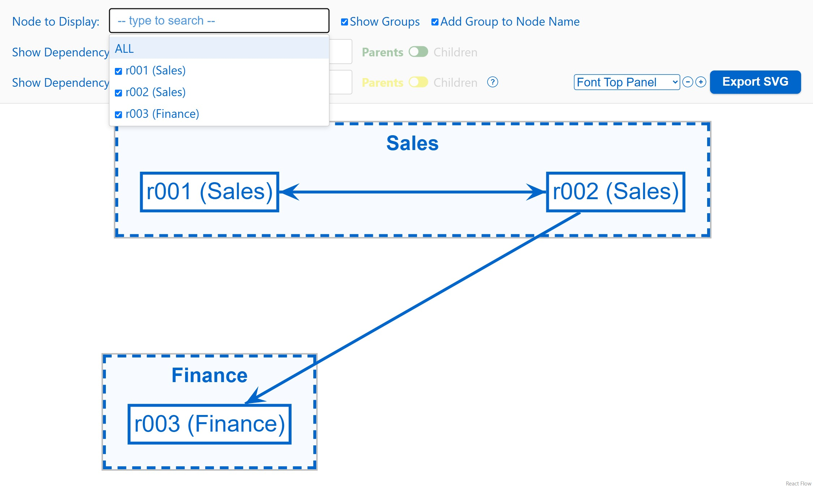
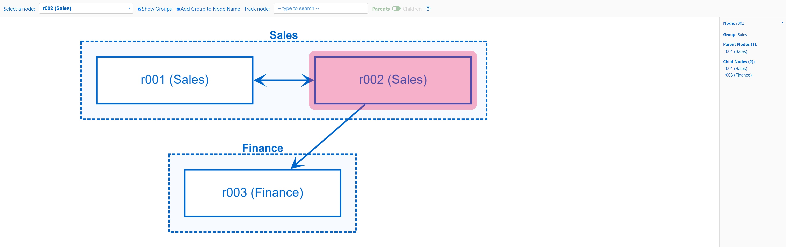
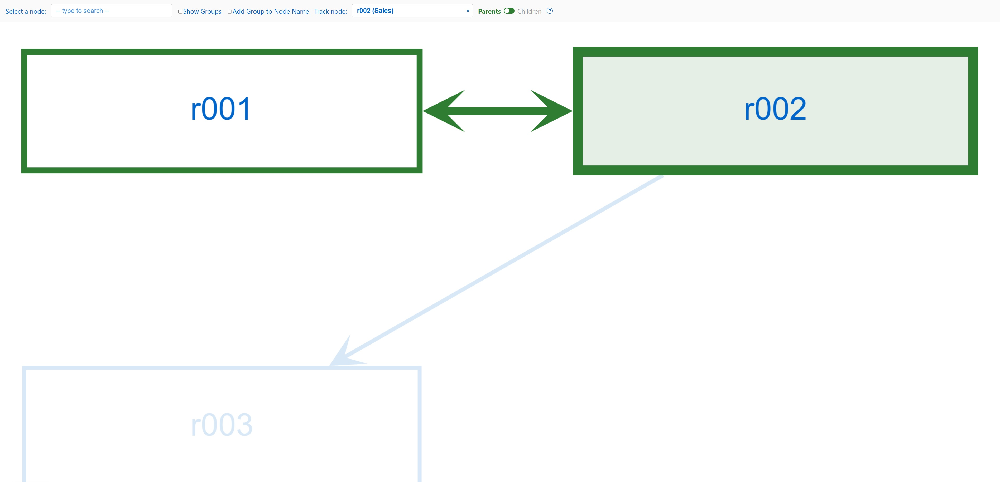

# react-beauti-graph

**react-beauti-graph by Antonio Ramasco**

A React component for drawing report dependency graphs with [Cytoscape](https://js.cytoscape.org/).
Give it your reports, the folders they belong to and the connections between them; it draws the graph
on a grid and adds search, tracing of parents and children, a details panel and clipboard export.



*The [quick start](#quick-start) example, with the* Select a node *list open.*

## Contents

- [Features](#features)
- [Install](#install)
- [Quick start](#quick-start)
- [Your data](#your-data)
- [Options](#options)
- [Using the graph](#using-the-graph)
- [Styling](#styling)
- [Other exports](#other-exports)
- [Development](#development)
- [License and credits](#license-and-credits)

## Features

- **Folders (groups)** drawn as dashed boxes around their reports; a report can be in several folders
- **Automatic grid layout** built from the folders, or your own layout row by row
- **Arrows** for connections: `[a, b]` + `[b, a]` become one line with arrows at both ends; `[a, a]` is drawn as a loop
- **Select a node**: partial, case-insensitive search; jumps to the report and opens its details
- **Track node**: highlights the whole chain of parents or children of a report and dims the rest
- **Details panel** (double click): the report, its group, its parents and children; click a name to jump to it
- **Save to clipboard** (right click): copies the same information as the details panel
- **Configurable** colors, text sizes and grid spacing

## Install

From the [GitHub release](https://github.com/ramasco/react-beauti-graph/releases/latest):

```bash
npm install https://github.com/ramasco/react-beauti-graph/releases/download/v1.1.0/react-beauti-graph-1.1.0.tgz
```

Requires React 18 or newer. Cytoscape is installed automatically.

## Quick start

```jsx
import { create_graph } from 'react-beauti-graph';
import 'react-beauti-graph/style.css';

// Reports inside each folder
const folders = { Sales: ['r001', 'r002'], Finance: ['r003'] };

// Arrows: [source, target]
const direct_node_connections = [
  ['r001', 'r002'],
  ['r002', 'r001'],
  ['r002', 'r003'],
];

// Create the component once, outside your own components
const MyGraph = create_graph(folders, direct_node_connections, { offsetX: 280, offsetY: 160 });

export default function Page() {
  // The graph fills its container, so give the container a height
  return (
    <div style={{ height: '100vh' }}>
      <MyGraph />
    </div>
  );
}
```

Works in Next.js (App Router) out of the box: the library is marked `'use client'`.

## Your data

```js
create_graph(folders, direct_node_connections, [layout], [options])
```

Returns a React component (no props). Call it once, at the top level of a module: calling it inside a
component would rebuild the graph on every render.

### `folders`

`{ [folderName]: string[] }`: the report names inside each folder (group).

```js
{ Sales: ['r001', 'r002'], Finance: ['r003'] }
```

- A report listed in **several folders** is drawn once in each. The copies are named `r001(1)`, `r001(2)`, …;
  arrows connect to the first one.
- Reports that appear only in `direct_node_connections` are drawn without a folder.

### `direct_node_connections`

`[source, target][]`: one arrow from `source` to `target`.

| You write | You get |
|---|---|
| `['a', 'b']` | an arrow from `a` to `b`: `a` is a **parent** of `b`, `b` is a **child** of `a` |
| `['a', 'b']` and `['b', 'a']` | one line with arrows at both ends |
| `['a', 'a']` | a loop on `a` |
| the same pair twice | one arrow |

### `layout` (optional)

Where each report sits, as a grid: one inner list per row, top to bottom.

```js
[
  ['r001', 'r002'], // row 1
  ['r003'],         // row 2
]
```

**Leave it out** and the layout is built from the folders: each folder starts a new row and fills rows of
at most `layoutColumns` reports (default 10); reports in no folder come last.

```js
create_graph(folders, direct_node_connections, options);         // layout built from the folders
create_graph(folders, direct_node_connections, layout, options);  // your own layout
```

When you give your own layout:

- Report *n* of row *r* is placed at `x = startX + n × offsetX`, `y = startY + r × offsetY` (counting from 1).
- Put every report in it: a report that is missing has no grid position.
- Reports listed only in the layout are still drawn.
- Place the copies of a report that is in several folders with their names: `r001(1)`, …
- Names that match no report are skipped, and a report listed twice keeps its first position
  (both with a warning in the browser console).

## Options

All optional.

| Option | Default | Description |
|---|---|---|
| `offsetX` | `200` | Horizontal distance between grid columns, in pixels |
| `offsetY` | `200` | Vertical distance between grid rows, in pixels |
| `startX`, `startY` | `0` | Position of the grid origin, in pixels |
| `base` | `1` | Number of the first row and column (`0` puts the first report on the origin) |
| `layoutColumns` | `10` | Reports per row when the layout is built from the folders |
| `selectedColor` | `'#e91e63'` (pink) | Highlight of the report picked in *Select a node* |
| `parentsColor` | `'#2e7d32'` (green) | *Track node*: chain of parents |
| `childrenColor` | `'#7b1fa2'` (purple) | *Track node*: chain of children |
| `topControlsFontSize` | `'22px'` | Text size of the top row; its spacing grows with it |
| `rightDisplayFontSize` | `'18px'` | Text size of the details panel |

Colors are `#rrggbb` strings; sizes are any CSS length (`'16px'`, `'1rem'`, …).

```js
const MyGraph = create_graph(folders, direct_node_connections, {
  offsetX: 280,
  offsetY: 160,
  parentsColor: '#1565c0',
  childrenColor: '#ef6c00',
  topControlsFontSize: '16px',
});
```

## Using the graph

### Select a node and the details panel

Pick a report in *Select a node*, or double click it: the graph zooms to it, highlights it in pink and opens
the details panel on the right with its group, its parent reports (arrows pointing to it) and its child
reports (arrows leaving it). Click a name in the panel to jump to that report.



*`r002` selected. `r001` is both a parent and a child because of the two-way arrow.*

### Track node

Pick a report in *Track node* to follow its whole chain, not just its direct neighbours: with *Parents*,
the reports pointing to it, the reports pointing to those, and so on; with *Children*, the same in the
other direction. The chain is drawn in green (parents) or purple (children), the tracked report is
filled, and everything else is dimmed.



*Parents of `r002`, with* Show Groups *and* Add Group to Node Name *turned off.*

### All controls

**Top row**

| Control | What it does |
|---|---|
| *Select a node* | Type part of a name, pick a report: the graph zooms to it and opens its details. *ALL* closes the details and shows the whole graph. |
| *Show Groups* | Shows or hides the folder boxes. |
| *Add Group to Node Name* | Writes the folder after each report name, e.g. `r001 (Sales)`. |
| *Track node* | Pick a report to highlight its whole chain (parents of parents, … or children of children, …) and dim the rest. *No tracking* turns it off. |
| *Parents / Children* | Which chain *Track node* follows. Disabled while nothing is tracked. |
| *?* | Short help. |

In both search boxes, use the arrow keys and Enter to pick, Escape to close the list, and × to clear.

**On the graph**

| Action | What it does |
|---|---|
| Double click a report | Opens the details panel: group, parent reports and child reports. Click a name there to jump to it. |
| Right click a report | *Save to clipboard*: copies the same information as text. |
| Scroll / drag | Zoom / move the view. |

When the window is too narrow, the top row continues on a second line.

## Styling

Import the styles once: `import 'react-beauti-graph/style.css'`. Everything is scoped under the
`.rbg-graph` class, so it does not affect the rest of your page. To change the look, override its rules
in your own CSS, for example:

```css
.rbg-graph .node-info-panel { width: 360px; }
.rbg-graph .controls { background: #fff; }
```

Colors and text sizes are easier to change with the [options](#options).

## Other exports

Building blocks used by the component, for building your own UI:

| Export | Description |
|---|---|
| `NodeSearch` | The search box: `<NodeSearch options={[{ id, label }]} selectedId={id} onSelect={(id) => …} noneLabel="ALL" />`. `''` means no node. |
| `getNodeInfo(node)` | For a Cytoscape node: `{ id, name, group, parents, children }` (parents and children sorted by name). |
| `formatNodeInfo(info)` | The clipboard text for the result of `getNodeInfo`. |

## Development

```bash
npm install
npm run dev        # demo app at http://localhost:3000
npm test           # unit tests (Vitest)
npm run build:lib  # build the npm package into dist/
```

| Path | Contents |
|---|---|
| `src/graphFactory.jsx` | The library: `create_graph`, layout, styles, search box |
| `src/react-beauti-graph.css` | The library styles (published as `style.css`) |
| `src/index.js` | Public entry point of the package |
| `src/App.jsx` | Demo page |
| `src/samples/` | Demo data: a small example and 100 reports in 5 folders |
| `src/__tests__/` | Unit tests |

In the demo, switch between the two samples with the import at the top of `src/App.jsx`.

## License and credits

Licensed under the [Apache License 2.0](LICENSE).

You are free to use, modify and distribute this library, including in commercial
products, provided you keep the attribution in the [NOTICE](NOTICE) file:

> react-beauti-graph by Antonio Ramasco
