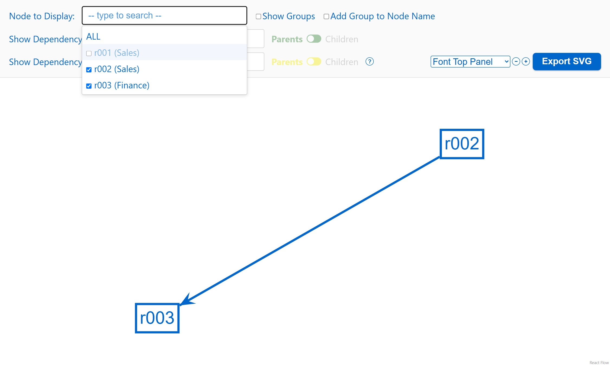
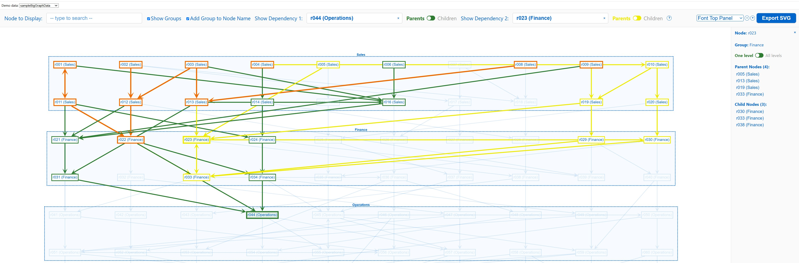

# react-beauti-graph

**react-beauti-graph by Antonio Ramasco**

A React component for drawing report dependency graphs with [React Flow](https://reactflow.dev/).
Give it your reports, the groups they belong to and the connections between them; it draws the graph
on a grid and adds search, tracing of parents and children, a details panel, clipboard export and SVG export.


_The [quick start](#quick-start) example, with the_ Node to Display _list open._

## Contents

- [Features](#features)
- [Release notes](#release-notes)
- [Install](#install)
- [Quick start](#quick-start)
  - [Frameworks](#frameworks)
- [Your data](#your-data)
- [Options](#options)
- [Using the graph](#using-the-graph)
  - [Node to Display and the details panel](#node-to-display-and-the-details-panel)
  - [Filter out nodes](#filter-out-nodes)
  - [Show Dependency](#show-dependency)
  - [Find common dependencies in two graphs](#find-common-dependencies-in-two-graphs)
  - [Text size](#text-size)
  - [All controls](#all-controls)
- [Styling](#styling)
- [Other exports](#other-exports)
- [Development](#development)
- [License and credits](#license-and-credits)

## Features

- **Groups** drawn as dashed boxes around their reports (React Flow sub flows); a report can be in several groups
- **Drag and drop**: move a report, or a whole group box with its reports; the boxes and arrows follow
- **Report boxes** as big as their text, drawn with React: sharp at any zoom, with keyboard focus and accessible markup
- **Automatic grid layout** built from the groups, or your own layout row by row
- **Arrows** for connections: `[a, b]` + `[b, a]` become one line with arrows at both ends; `[a, a]` is drawn as a loop
- **Node to Display**: partial, case-insensitive search; jumps to the report and opens its details
- **Filter out nodes**: a checkbox next to each report in the _Node to Display_ list shows or hides it
- **Show Dependency 1 and 2**: highlight the whole chain of parents or children of a report in two colors, and dim the rest
- **Details panel** (double click): the report, its group, its parents and children, one level or all levels; click a name to jump to it
- **Save to clipboard** (right click): copies the same information as the details panel
- **Export SVG** button: downloads the whole graph as a vector `graph.svg` file (a static image, not interactive)
- **Text size buttons** (− / +) for the top row, the details panel and the graph
- **Configurable** colors, text sizes and grid spacing

## Release notes

### 2.0.0

The graph is now drawn with [React Flow](https://reactflow.dev/) instead of Cytoscape, and the groups are React Flow
sub flows (a group box that holds its reports).

- **React Flow** replaces Cytoscape: reports and groups are React components, arrows are SVG; zoom, pan, fit and animated jumps to a report work as before
- **Smaller install**: `cytoscape` and `cytoscape-svg` are gone; the only graph dependency is `@xyflow/react`
- **Move boxes**: drag a report to move it, or drag a group box to move the group with all its reports; the group boxes and the arrows follow, and _Reset layout_ puts everything back
- **Same screen, same options**: `create_graph(node_groups, direct_node_connections, [layout], [options])`, every option, the top row, the details panel, Show Dependency 1 and 2, the text size buttons and _Export SVG_ work as in 1.3
- **Export SVG** is now written by the library from the same boxes and colors as the screen (what is dimmed or hidden stays so)
- The graph logic (layout, parents and children, chains, hidden reports) is plain functions in `src/graph.ts`, tested without a browser; a smoke test draws the example app in Chrome
- **Breaking:**
  - `getNodeInfo(elements, id, allLevels?)` now takes the elements of the graph (from `buildGraph`) and a report id, not a Cytoscape node
  - `downloadSvg(cy)` is replaced by `buildSvg(...)` and `downloadSvg(markup)`
  - the report boxes are not Cytoscape elements any more, so Cytoscape CSS or style code no longer applies

### 1.3.2

- **README**: new chapter [Find common dependencies in two graphs](#find-common-dependencies-in-two-graphs): pick a chain in _Show Dependency 1_ and one in _Show Dependency 2_, and the common reports and arrows show in orange, with a new screenshot
- No code changes

### 1.3.1

- **Export SVG**: a blue button at the right end of the top row saves the whole graph (not only the visible part) as `graph.svg`, using [`cytoscape-svg`](https://github.com/kinimesi/cytoscape-svg), which is now a dependency. The graph is still drawn on canvas; the SVG is an export only.
- **Top row layout**: the text size dropdown with − / + and _Export SVG_ sit together at the right end of the row, after the _?_ help
- **`downloadSvg(cy)`**: the same export, available in code (takes a Cytoscape core instance)
- Typecheck, lint, format check and all 85 tests pass (`npm run check`)

### 1.3.0

- **Report boxes fit their text**: each box is as big as its label plus a little padding (it was a fixed 200 × 60); the _Font Graph Panel_ − / + buttons resize the boxes with the text
- Built and type-checked with TypeScript 7; dependencies updated
- **Show Dependency 1 and 2**: two independent chains of parents or children, each with its own colors; reports and arrows on both use `commonColor`
- **Details panel**: _One level / All levels_ switch, also used by _Save to clipboard_
- **Text size**: dropdown with − / + buttons for the top row, the details panel and the graph
- **Renamed controls**: _Node to Display_, _Show Dependency_, _Show Nothing_
- **`node_groups`** is the name of the first `create_graph` argument (it was `folders`; the argument is positional, so existing calls keep working)
- **TypeScript**: written in strict TypeScript, with generated type definitions for ESM and CommonJS
- **Example app**: now a separate project in `examples/` (Vite); Next.js is no longer used

## Install

From [npm](https://www.npmjs.com/package/react-beauti-graph) (latest version):

```bash
npm install react-beauti-graph@latest
```

Or from the [GitHub release](https://github.com/ramasco/react-beauti-graph/releases/latest):

```bash
npm install https://github.com/ramasco/react-beauti-graph/releases/download/v2.0.0/react-beauti-graph-2.0.0.tgz
```

Requires React 18 or newer. React Flow (`@xyflow/react`) is installed automatically.

Want to try it first? The example app in `examples/` runs the graph with sample data: see [Development](#development).

## Quick start

```jsx
import { create_graph } from 'react-beauti-graph';
import 'react-beauti-graph/style.css';

// Reports inside each group
const node_groups = { Sales: ['r001', 'r002'], Finance: ['r003'] };

// Arrows: [source, target]
const direct_node_connections = [
  ['r001', 'r002'],
  ['r002', 'r001'],
  ['r002', 'r003'],
];

// Create the component once, outside your own components
const MyGraph = create_graph(node_groups, direct_node_connections, { offsetX: 280, offsetY: 160 });

export default function Page() {
  // The graph fills its container, so give the container a height
  return (
    <div style={{ height: '100vh' }}>
      <MyGraph />
    </div>
  );
}
```

### Frameworks

Plain React (Vite, Create React App, Remix, Gatsby, ...) needs nothing special: install the package and
import `react-beauti-graph/style.css` once.

**Next.js (App Router):** the library is marked `'use client'`, so it can be imported from any component.
It draws in the browser only, so call `create_graph` and render `<MyGraph />` inside a client component
(a file starting with `'use client'`), not in a server component.

**TypeScript:** type definitions are included (`create_graph` and its options, `getNodeInfo`, `formatNodeInfo`, `NodeSearch`).

## Your data

```js
create_graph(node_groups, direct_node_connections, [layout], [options]);
```

Returns a React component (no props). Call it once, at the top level of a module: calling it inside a
component would rebuild the graph on every render.

### `node_groups`

`{ [groupName]: string[] }`: the report names inside each group.

```js
{ Sales: ['r001', 'r002'], Finance: ['r003'] }
```

- A report listed in **several groups** is drawn once in each. The copies are named `r001(1)`, `r001(2)`, …;
  arrows connect to the first one.
- Reports that appear only in `direct_node_connections` are drawn without a group.

### `direct_node_connections`

`[source, target][]`: one arrow from `source` to `target`.

| You write                     | You get                                                                         |
| ----------------------------- | ------------------------------------------------------------------------------- |
| `['a', 'b']`                  | an arrow from `a` to `b`: `a` is a **parent** of `b`, `b` is a **child** of `a` |
| `['a', 'b']` and `['b', 'a']` | one line with arrows at both ends                                               |
| `['a', 'a']`                  | a loop on `a`                                                                   |
| the same pair twice           | one arrow                                                                       |

### `layout` (optional)

Where each report sits, as a grid: one inner list per row, top to bottom.

```js
[
  ['r001', 'r002'], // row 1
  ['r003'], // row 2
];
```

**Leave it out** and the layout is built from the groups: each group starts a new row and fills rows of
at most `layoutColumns` reports (default 10); reports in no group come last.

```js
create_graph(node_groups, direct_node_connections, options); // layout built from the groups
create_graph(node_groups, direct_node_connections, layout, options); // your own layout
```

When you give your own layout:

- Report _n_ of row _r_ is placed at `x = startX + n × offsetX`, `y = startY + r × offsetY` (counting from 1).
- Put every report in it: a report that is missing has no grid position.
- Reports listed only in the layout are still drawn.
- Place the copies of a report that is in several groups with their names: `r001(1)`, …
- Names that match no report are skipped, and a report listed twice keeps its first position
  (both with a warning in the browser console).

## Options

All optional.

| Option                 | Default              | Description                                                                  |
| ---------------------- | -------------------- | ---------------------------------------------------------------------------- |
| `offsetX`              | `200`                | Horizontal distance between grid columns, in pixels                          |
| `offsetY`              | `200`                | Vertical distance between grid rows, in pixels                               |
| `startX`, `startY`     | `0`                  | Position of the grid origin, in pixels                                       |
| `base`                 | `1`                  | Number of the first row and column (`0` puts the first report on the origin) |
| `layoutColumns`        | `10`                 | Reports per row when the layout is built from the groups                     |
| `selectedColor`        | `'#e91e63'` (pink)   | Highlight of the report picked in _Node to Display_                          |
| `parentsColor`         | `'#2e7d32'` (green)  | _Show Dependency 1_: chain of parents                                        |
| `childrenColor`        | `'#7b1fa2'` (purple) | _Show Dependency 1_: chain of children                                       |
| `track2ParentsColor`   | `'#efeb00'` (yellow) | _Show Dependency 2_: chain of parents                                        |
| `track2ChildrenColor`  | `'#8b4513'` (brown)  | _Show Dependency 2_: chain of children                                       |
| `commonColor`          | `'#ef6c00'` (orange) | Reports and arrows on both _Show Dependency_ chains                          |
| `topControlsFontSize`  | `'22px'`             | Text size of the top row; its spacing grows with it                          |
| `rightDisplayFontSize` | `'18px'`             | Text size of the details panel                                               |

The option names keep the older "track" wording: `parentsColor` and `childrenColor` are for _Show Dependency 1_, and the `track2…` options are for _Show Dependency 2_.

Colors are `#rrggbb` or `rgb(239, 108, 0)` strings; sizes are any CSS length
(`'16px'`, `'1rem'`, …). All the defaults live in `src/default_setting.ts`.

```js
const MyGraph = create_graph(node_groups, direct_node_connections, {
  offsetX: 280,
  offsetY: 160,
  parentsColor: '#1565c0',
  childrenColor: '#ef6c00',
  topControlsFontSize: '16px',
});
```

## Using the graph

### Node to Display and the details panel

Pick a report in _Node to Display_, or double click it: the graph zooms to it, highlights it in pink and opens
the details panel on the right with its group, its parent reports (arrows pointing to it) and its child
reports (arrows leaving it). Click a name in the panel to jump to that report.

Under the group, the **One level / All levels** switch (_One level_ at first) chooses what the lists show:
_One level_ lists the direct parents and children only; _All levels_ lists every report above it (parents of
parents, …) and every report below it (children of children, …). The choice also applies to _Save to clipboard_.


_`r002` selected. `r001` is both a parent and a child because of the two-way arrow._

### Filter out nodes

Each report in the _Node to Display_ list has a checkbox, checked at first. Uncheck it to remove the report
and its arrows from the graph; check it again to bring them back. A group whose reports are all unchecked
disappears too. Hidden reports stay in the list, greyed out.

Clicking a checkbox does not select the report and keeps the list open, so you can hide several in a row.
Picking a hidden report by name shows it again, and _ALL_ zooms to fit the reports that are shown.



_`r001` unchecked, with_ Show Groups _and_ Add Group to Node Name _turned off: only `r002 → r003` is left._

### Show Dependency

Pick a report in _Show Dependency 1_ to follow its whole chain, not just its direct neighbours: with _Parents_,
the reports pointing to it, the reports pointing to those, and so on; with _Children_, the same in the
other direction. The chain is drawn in the track's parents or children color (green or purple by default), the tracked report is
filled, and everything else is dimmed.

_Show Dependency 2_ works the same way with its own _Parents / Children_ switch and its own colors
(yellow and brown by default), so two chains can be compared. Reports and arrows on both
chains are drawn in the common color (`commonColor`, orange by default).


_Parents of `r002`, with_ Show Groups _and_ Add Group to Node Name _turned off._

### Find common dependencies in two graphs

To see which reports two reports have in common upstream or downstream:

1. In _Show Dependency 1_, pick the first report, then choose **Parents** or **Children** to draw its chain (its subgraph).
2. In _Show Dependency 2_, pick the second report, then choose **Parents** or **Children** to draw its chain.
3. The reports and arrows that belong to both chains are drawn in orange (`commonColor`): these are the common nodes. Everything else on the two chains keeps its own color, and the rest is dimmed.

Use _Show Nothing_ in either box to clear its chain. Double click an orange report to list its parents and children in the details panel.



_Common nodes from two dependencies, on the 100-report sample: the parents of `r044` (Show Dependency 1, green) and the parents of `r023` (Show Dependency 2, yellow). The reports and arrows on both chains are drawn in orange._

### Text size

The dropdown and the **−** / **+** buttons at the end of the top row change the text size while you look
at the graph. Pick what to resize in the dropdown, then click **−** or **+**:

| Dropdown                        | What changes                                                                                       |
| ------------------------------- | -------------------------------------------------------------------------------------------------- |
| _Font Top Panel_ (first choice) | The top row: labels, search boxes, switches and buttons                                            |
| _Font Right Panel_              | The details panel (open it by double clicking a report)                                            |
| _Font Graph Panel_              | The text in the graph: report names and group names. The report boxes grow or shrink with the text |

- Each click changes the size by 2px, from 8px smaller to 16px larger than the starting size. The button
  is greyed out at the limit.
- Each area keeps its own size when you switch the dropdown to another one.
- The starting sizes of the top row and the details panel are the `topControlsFontSize` and
  `rightDisplayFontSize` [options](#options) (`22px` and `18px`). The graph text starts at 16px for reports and
  14px for groups and has no option.
- Sizes are not saved: they go back to the starting size when the page is reloaded.
- With a large graph text, reports can touch each other; increase `offsetX` and `offsetY` to give them more room.

### All controls

**Top row**

| Control                                                 | What it does                                                                                                                                                                                      |
| ------------------------------------------------------- | ------------------------------------------------------------------------------------------------------------------------------------------------------------------------------------------------- |
| _Node to Display_                                       | Type part of a name, pick a report: the graph zooms to it and opens its details. _ALL_ closes the details and shows the whole graph.                                                              |
| Checkbox next to a report in the _Node to Display_ list | Shows or hides the report and its arrows; see [Filter out nodes](#filter-out-nodes).                                                                                                              |
| _Show Groups_                                           | Shows or hides the group boxes.                                                                                                                                                                   |
| _Add Group to Node Name_                                | Writes the group after each report name, e.g. `r001 (Sales)`.                                                                                                                                     |
| _Show Dependency 1_, _Show Dependency 2_                | Pick a report to highlight its whole chain (parents of parents, … or children of children, …) and dim the rest. _Show Nothing_ turns it off. Where the two chains meet, the common color is used. |
| _Parents / Children_                                    | Which chain the _Show Dependency_ next to it follows. Disabled while nothing is tracked.                                                                                                          |
| _Font Top Panel / Font Right Panel / Font Graph Panel_  | Dropdown that picks which text the next two buttons resize: the top row, the details panel, or the labels and boxes of the graph.                                                                 |
| _−_ and _+_                                             | Make the chosen text 2px smaller or larger (from 8px smaller to 16px larger than the configured size). Each area keeps its own size; they reset when the page is reloaded.                        |
| _Reset layout_                                          | Appears once a box has been moved: puts every box back where the layout placed it. Moves are not saved: reloading the page also resets them.                                                      |
| _Export SVG_                                            | Downloads the whole graph as `graph.svg` (all reports and groups, whatever the zoom). The file is a static image: no search, details or highlighting.                                             |
| _?_                                                     | Short help.                                                                                                                                                                                       |

In all search boxes, use the arrow keys and Enter to pick, Escape to close the list, and × to clear.

**On the graph**

| Action                                          | What it does                                                                                                 |
| ----------------------------------------------- | ------------------------------------------------------------------------------------------------------------ |
| Double click a report                           | Opens the details panel: group, parent reports and child reports. Click a name there to jump to it.          |
| Right click a report                            | _Save to clipboard_: copies the same information as text.                                                    |
| _One level / All levels_ switch (details panel) | Lists only the direct parents and children, or the whole chains.                                             |
| Drag a report                                   | Moves it. The group box around it and the arrows follow. _Reset layout_ in the top row puts everything back. |
| Drag a group box                                | Moves the group with all its reports.                                                                        |
| Scroll / drag the background                    | Zoom / move the view.                                                                                        |

When the window is too narrow, the top row continues on a second line.

## Styling

Import the styles once: `import 'react-beauti-graph/style.css'`. Everything is scoped under the
`.rbg-graph` class, so it does not affect the rest of your page. To change the look, override its rules
in your own CSS, for example:

```css
.rbg-graph .node-info-panel {
  width: 360px;
}
.rbg-graph .controls {
  background: #fff;
}
```

The boxes have their own classes you can style: `.rbg-report` (a report box), `.rbg-group` (a group box) and
`.react-flow` (the canvas, see the [React Flow styling guide](https://reactflow.dev/learn/customization/theming)).
The small _React Flow_ link at the bottom right of the canvas is React Flow's own attribution.

Colors and text sizes are easier to change with the [options](#options); viewers can also resize the text with the buttons described in [Text size](#text-size).

## Other exports

Building blocks used by the component, for building your own UI:

| Export                                                        | Description                                                                                                                                                                                                                                     |
| ------------------------------------------------------------- | ----------------------------------------------------------------------------------------------------------------------------------------------------------------------------------------------------------------------------------------------- |
| `NodeSearch`                                                  | The search box: `<NodeSearch options={[{ id, label }]} selectedId={id} onSelect={(id) => …} noneLabel="ALL" />`. `''` means no node. Add `onToggleVisible={(id) => …}` and `hiddenIds={new Set([...])}` to show a checkbox next to each node.   |
| `getNodeInfo(elements, id, allLevels?)`                       | For the report `id` in the elements from `buildGraph`: `{ id, name, group, parents, children }` (parents and children sorted by name). With `allLevels` set to `true`, the lists hold every ancestor and descendant instead of the direct ones. |
| `buildGraph(node_groups, direct_node_connections, extraIds?)` | The elements of the graph (groups, reports and arrows) that `getNodeInfo` reads.                                                                                                                                                                |
| `formatNodeInfo(info)`                                        | The clipboard text for the result of `getNodeInfo`.                                                                                                                                                                                             |
| `buildSvg(groups, reports, edges)`, `downloadSvg(markup)`     | Makes the text of a static SVG picture from boxes and arrows, and downloads SVG text as `graph.svg`. The _Export SVG_ button uses both.                                                                                                         |

## Development

### How it is built

`create_graph` turns your groups and connections into plain data first (`src/graph.ts`: elements, grid layout,
box sizes, parents and children, the tracked chains, colors and arrow geometry), then draws it with React Flow
(`src/createGraph.tsx`): every report is a React component sized to its text, every group is a React Flow sub flow
around its reports, and every arrow is an SVG line from the border of one box to the border of the other.
The logic has no drawing in it, so it is tested without a browser (`tests/`); `npm run smoke` draws the example
app in Chrome and checks that the boxes and arrows are really there.

The library is written in TypeScript (strict mode); its type definitions are generated from the source when
you build the package. Code is type-checked and compiled with TypeScript 7 (the `typescript7` package); `typescript` 6 stays
installed only because `typescript-eslint` does not support version 7 yet. The library and the example app are two separate projects, each with its own `package.json`:

| Folder      | Contents                                                                                              |
| ----------- | ----------------------------------------------------------------------------------------------------- |
| `src/`      | **Source code of the library** (this is what gets published)                                          |
| `tests/`    | **Unit tests** (Vitest)                                                                               |
| `examples/` | **Example app**, its own project: it only imports the package `react-beauti-graph`, as any user would |

**Library** (project root):

```bash
npm install
npm test           # unit tests (Vitest)
npm run typecheck  # TypeScript 7, strict (library, tests and example app)
npm run lint       # ESLint, strict rules (eslint.config.mjs)
npm run format     # Prettier: formats the code (npm run format:check only checks)
npm run check      # typecheck + lint + format check + tests: run it before a commit
npm run build:lib  # build the npm package (code and .d.ts types) into dist/
npm run smoke      # draws the example app in Chrome or Edge and checks the arrows are painted
```

**Example app** (`examples/`):

```bash
cd examples
npm install
npm run dev        # example app (Vite) at http://localhost:5173
npm run build      # build the example app into examples/dist/
```

On Windows, `examples/run.cmd` installs the example's dependencies the first time and starts it. From the root,
`npm run dev` does the same as `cd examples && npm run dev`. While developing, the name `react-beauti-graph`
points at the library source in `src/` (see `examples/vite.config.mjs`), so library changes show up at once.

| Path                                                             | Contents                                                                                                          |
| ---------------------------------------------------------------- | ----------------------------------------------------------------------------------------------------------------- |
| `src/createGraph.tsx`                                            | `create_graph`: the React component (React Flow canvas, top row, details panel)                                   |
| `src/graph.ts`                                                   | The graph without drawing: elements, grid layout, box sizes, parents and children, chains, colors, arrow geometry |
| `src/NodeSearch.tsx`, `src/svg.ts`                               | The search box, and the SVG export                                                                                |
| `src/default_setting.ts`                                         | Default colors, text sizes and layout (the `DEFAULT_*` values)                                                    |
| `src/react-beauti-graph.css`                                     | The library styles (published as `style.css`)                                                                     |
| `src/index.ts`                                                   | Public entry point of the package (the `.d.ts` types are generated into `dist/`)                                  |
| `tests/`                                                         | `graph.test.ts`, `NodeSearch.test.tsx`                                                                            |
| `tsconfig.json`, `tsconfig.build.json`                           | TypeScript settings (strict), and the settings that generate the types                                            |
| `scripts/`                                                       | `smoke.mjs` (browser smoke test) and `make-cts.mjs` (finishes the type files)                                     |
| `.github/workflows/ci.yml`                                       | GitHub Actions: runs the check, the package build and the smoke test on every push                                |
| `vite.lib.config.mjs`, `vitest.config.mjs`                       | Build of the npm package, and the test setup                                                                      |
| `examples/App.tsx`                                               | The example page, with the _Demo data_ dropdown                                                                   |
| `examples/main.tsx`, `examples/index.html`, `examples/index.css` | The Vite entry that mounts the example page, and its page styles                                                  |
| `examples/samples/`                                              | Example data: a small example and 100 reports in 5 groups                                                         |
| `examples/package.json`, `examples/vite.config.mjs`              | The example app's own dependencies and Vite setup                                                                 |

In the example app, switch between the two samples with the _Demo data_ dropdown at the top of the page.

## License and credits

Licensed under the [Apache License 2.0](LICENSE).

You are free to use, modify and distribute this library, including in commercial
products, provided you keep the attribution in the [NOTICE](NOTICE) file:

> react-beauti-graph by Antonio Ramasco
